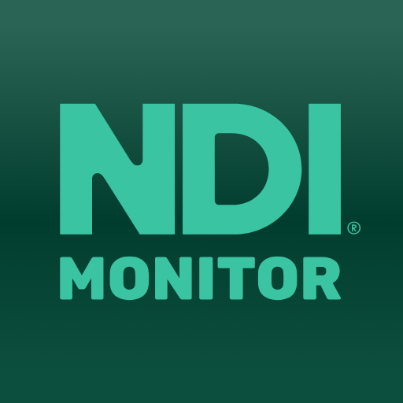
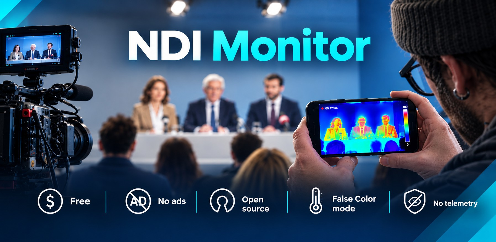
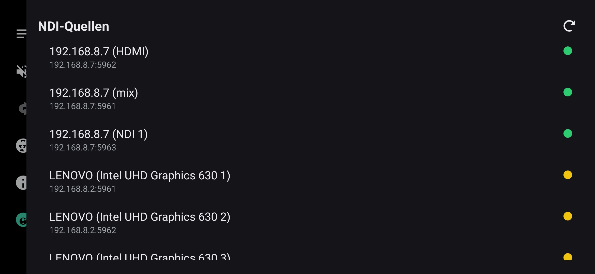
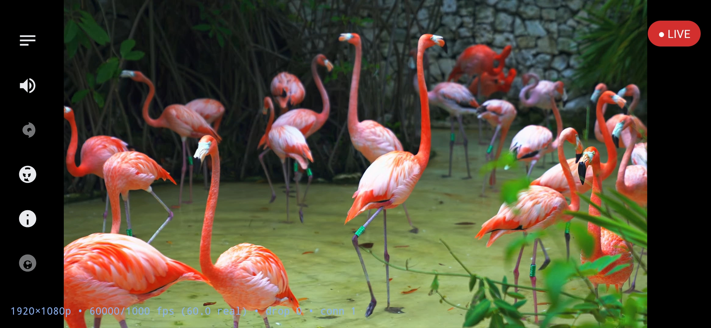
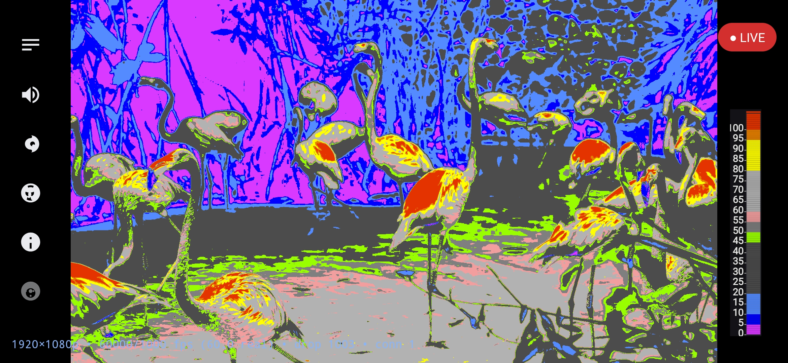
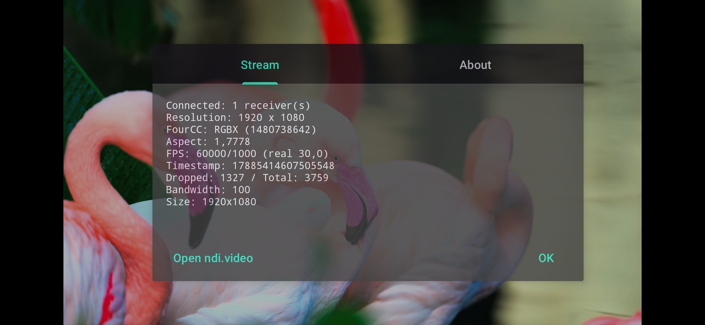

<p align="center"></p>

# NDI monitor for Android



> ## 🆕 Now with NDI HX decoding
>
> **Since version 1.0.6, NDI monitor decodes NDI HX (H.264 / H.265) sources as well as
> Full NDI.** Cameras, encoders and NDI Screen Capture HX now show video instead of
> *"Video decoder not found"*.
>
> ### ⬇️ [Download the latest APK](https://github.com/studiokrause/ndi-viewer-android/releases/latest)

A minimal, standalone NDI® receiver for Android based on the NewTek/Vizrt NDI SDK
(`v6.4.0.2`). It detects NDI sources on the network (mDNS), displays video with audio
from both Full NDI and NDI HX (H.264 / H.265) senders, and allows manual connection
using `IP[:port]`.

|  |  |
|---|---|
|  |  |

## Architecture

```
app/
├── src/main/
│   ├── AndroidManifest.xml
│   ├── jniLibs/{arm64-v8a,armeabi-v7a,x86,x86_64}/
│   │   ├── libndi.so                             ← NDI SDK
│   │   └── libavcodec-ndi.so, libavutil-ndi.so   ← FFmpeg (NDI HX decoders)
│   ├── cpp/
│   │   ├── CMakeLists.txt
│   │   ├── ndi_jni.cpp                           ← native JNI bridge (+ I420/YV12/NV12)
│   │   └── ndi/Processing.NDI.*.h                ← NDI headers
│   └── java/com/lekozaur/ndiviewerhx/
│       ├── DecodeStatus.kt / SourceProbe.kt      ← source status probe
│       ├── NdiNative.kt   (JNI surface: NdiFinderJni, NdiReceiverJni, NdiNative)
│       ├── NdiFinder.kt   (discovery thread: wait_for_sources + get_current_sources)
│       ├── NdiStream.kt   (video + statistics threads + JNI orchestration)
│       ├── VideoRenderer.kt (FitSurfaceView, double-buffered bitmap, aspect-fit)
│       ├── SourceAdapter.kt (RecyclerView + green/yellow/red status dot)
│       ├── LocaleHelper.kt (PL/EN/DE/ES/IT/FR)
│       └── MainActivity.kt (UI: top sheet, left vertical bar, LIVE red chip)
```

### Data Flow

```
NDI Sender ──TCP/UDP (mDNS)──► NDI SDK (libndi.so)
                                   │
                                   ▼  NdiReceiverJni.capture (video thread)
                    copy/convert: RGBA/BGRX/BGRA/UYVY → RGBA  (BT.709 limited)
                                   │  (DirectByteBuffer, zero-copy within JNI boundaries)
                                   ▼
                            Renderer.onFrame (video thread)
                          Bitmap.copyPixelsFromBuffer (2x ping-pong)
                                   │
                                   ▼  Choreographer ~120 Hz (UI thread)
                            FitSurfaceView → drawBitmap aspect-fit
                                   ▲
                                   │
                          Audio (native audio thread)
                          capture_v2 audio → SPSC ring → AAudio stream (PCM float)
```

### Key Decisions

- **Forced color format**: we receive using `NDIlib_recv_color_format_RGBX_RGBA` — the SDK
  itself performs the down-conversion from UYVY/4:2:2 to RGBA. This maps directly to
  `Bitmap.Config.ARGB_8888` (RGBA in memory, BE→LE).
- **Fallback conversion**: if the source sends UYVY despite the preference (e.g. in
  `fastest` mode), the wrapper performs `UYVY→RGBA` (BT.709 limited, 4:2:2) in C++.
- **Zero allocations in the hot path**: the wrapper maintains two global `DirectByteBuffer`
  instances sized `stride*height` and switches the index for each frame. In Java, two
  `Bitmap` instances (ping-pong) receive `copyPixelsFromBuffer` — with no GC overhead.
- **Threads**: native video + audio run on two separate threads
  (`NDIlib_recv_capture_v2` supports simultaneous calls from multiple threads — this is
  guaranteed by the SDK). Statistics run on a third thread every 1 second.
- **Audio**: AAudio low-latency, PCM float format, downmixes more than 2 channels to stereo
  (NDI typically provides 2/8/16 channels). The AAudio stream is restarted when the format
  changes (rare). Muting is controlled using an atomic bool.
- **Power-saving mode**: `BANDWIDTH_LOWEST=0` reduces resolution and compression
  (useful over Wi-Fi), while `BANDWIDTH_HIGHEST=100` provides full quality.
- **Aspect ratio**: `FitSurfaceView` calculates `onMeasure` based on
  `picture_aspect_ratio` (or `xres/yres`) and maintains letterboxing both vertically
  and horizontally.
- **Discoverability**: mDNS requires a `MulticastLock` — acquired when the
  `BottomSheetDialog` is opened and released when it is closed.
- **Lifecycle**: the Activity's `configChanges` keeps the orientation without restarting.
  `singleTask` prevents multiple instances.

## NDI HX decoding (FFmpeg)

The NDI SDK decodes Full NDI (SpeedHQ) itself, but not H.264, H.265 or AAC: for those
`libndi.so` loads FFmpeg at runtime, by the names `libavcodec-ndi.so.61` /
`libavcodec.so.61` and `libavutil-ndi.so.59` / `libavutil.so.59`. Android provides
neither to apps, so without them every NDI HX source shows the SDK's
*"Video decoder not found"* picture.

The app therefore ships its own build of **FFmpeg 7.1.5**, reduced to the `h264`,
`hevc`, `aac` and `aac_latm` decoders (software decoding):

- An APK only packages files ending in `.so`, so the libraries are named
  `libavcodec-ndi.so` / `libavutil-ndi.so` and carry the versioned SONAME.
  `NdiNative.init()` loads them before `libndi`, which then resolves them by SONAME.
- Rebuild them (NDK r27; Linux, macOS or Git Bash on Windows) from the official
  [source archive](https://ffmpeg.org/releases/ffmpeg-7.1.5.tar.xz):

```bash
ANDROID_NDK=/path/to/ndk tools/build-ffmpeg-android.sh ffmpeg-7.1.5.tar.xz
```

FFmpeg is used under the **GNU LGPL v2.1 or later**
([license text](third_party/ffmpeg/COPYING.LGPLv2.1)), built without GPL or non-free
parts and linked dynamically; the sources are unmodified (the build script only changes
the generated linker setting for the SONAME). H.264, H.265 and AAC may be covered by
patents — licensing them for a distributed product is the distributor's responsibility,
as the NDI SDK documentation also notes.

## Build Configuration

| Element        | Value                                  |
| -------------- | -------------------------------------- |
| Gradle         | 8.11.1 (cached)                        |
| AGP            | 8.9.1                                  |
| Kotlin         | 2.1.21                                 |
| NDK            | 27.1.12297006                          |
| CMake (Android)| 3.22.1                                 |
| compileSdk     | 36                                     |
| minSdk         | 26 (required by AAudio)                |
| targetSdk      | 36                                     |
| JDK            | 17 – 21 (`JAVA_HOME`)                  |
| ABIs           | arm64-v8a, armeabi-v7a, x86, x86_64    |
| NDI SDK        | v6.4.0.2                               |
| FFmpeg         | 7.1.5 (LGPL, decoders only)            |

## Building

```bat
cd D:\lekozaur\ndiviewerhx
gradlew.bat --no-daemon assembleDebug
```

Output: `app/build/outputs/apk/debug/app-debug.apk`.

Gradle uses the JDK from `JAVA_HOME`; Gradle 8.11.1 does not run on JDK 24 or newer.
A signed release build (`assembleRelease`) additionally needs `keystore.properties`
and the keystore it points to; neither is part of the repository.

## Decode Status Indicator (v0.5)

The source list displays a colored dot on the right-hand side of the name:

| Color | Meaning | FourCC |
|-------|---------|--------|
| 🟢 Green | A video frame arrived in a format the app can display (`UYVY`, `UYVA`, `RGBA/BGRA` + `I420/YV12/NV12`). |
| 🟡 Yellow | **May work** — no frame received during the 8 s probe, or a 16-bit format (`P216/PA16`). Worth trying. |
| 🔴 Red | A frame arrived in a format the app cannot convert. |

Every new entry is probed in the background by `SourceProbe` (creates a temporary
`NdiReceiverJni`, waits up to 8 s for the first video frame, classifies its `FourCC`
via `DecodeClassifier`, and updates `SourceAdapter` through `updateStatus`).

## Visual Helpers - BETA (branch `visual-helpers` / `NDI-discovery`)

> **BETA** - experimental features, may lower FPS on 4K. Branch `visual-helpers` is not merged into `main`.

- **False Color** (`VideoRenderer.falseColorEnabled`, `btnFalseColor` in left bar): heatmap via `FalseColorTable` (IRE 0..108 from `falsecolor.json`: 0 White #FFFFFF -> 2 Blue #020346 -> 10 Light Blue #2496FF -> 20 Dark Grey #52524F -> 42 Bright Purple #FE1BFE -> 48 Medium Gray -> 52 Green -> 58 Light Grey -> 78 Dark Yellow -> 84 Yellow -> 94 Orange -> 100 Red #DE0E0D, maps luma 16->0 IRE, 235->100 IRE). Scale `FalseColorScaleView` 33dp with 29sp right-justified numbers, draggable. Toggle, icon alpha 1.0/0.5. Histogram removed in v0.8.0 per request.

Build from branch:
```bat
git checkout visual-helpers
gradlew.bat --no-daemon assembleDebug
```

## NDI Discovery Server — removed (Play policy)

> The background discovery server (`NdiDiscoveryService` / `NdiDiscoveryServer`, BETA on branch
> `NDI-discovery`) was removed from `main` in v1.0.1: keeping mDNS warm in the background requires
> a `dataSync` foreground service, which Google Play only allows for user-initiated data transfers.
> Source discovery works while the app is open (source list → `NdiFinder` + `MulticastLock`), with no
> background service and no extra permissions.

## Limitations / TODO

- NDI HX is decoded in software by FFmpeg; high-resolution or high-frame-rate H.265
  streams may be too heavy for slower devices. Hardware decoding (MediaCodec) is not
  used.
- Audio may require minor tuning for a specific device (NDI typically uses 48 kHz,
  and the default AAudio path is also 48 kHz on Android).
- Video/audio synchronization in the first version is based on displaying frames as
  quickly as they arrive (as-fast-as-possible). For demanding broadcast applications,
  using `NDIlib_FrameSync` instead of raw `recv_capture` is recommended.

## NDI License

The application embeds `libndi.so` from the official NDI SDK package (EULA
`NDI SDK License Agreement.pdf`). Production use requires acceptance of the
Vizrt NDI license terms.


## Trademarks, Copyright and NDI SDK Notice

NDI® is a registered trademark of Vizrt NDI AB and is used under applicable license terms.

This application uses the NDI® SDK provided by Vizrt (formerly NewTek). The NDI SDK, including `libndi.so` and the associated header files, is proprietary software owned by Vizrt and/or its licensors and is subject to the **NDI SDK License Agreement**.

This project is not affiliated with, endorsed by, sponsored by, or otherwise officially associated with Vizrt or NewTek.

All trademarks, service marks, product names, logos, and company names mentioned in this project are the property of their respective owners.

Copyright © 2026 the authors of NDI monitor for Android - and Opencode :).

This software uses libraries from the [FFmpeg](https://ffmpeg.org) project under the LGPL v2.1 or later; FFmpeg is a trademark of Fabrice Bellard, originator of the FFmpeg project.

The source code of this application is distributed under the license specified in this repository. This license does **not** grant any rights to redistribute, modify, or otherwise use the NDI SDK beyond the rights expressly granted by the applicable NDI SDK License Agreement.

For commercial or production distribution, ensure that your use and distribution of the NDI SDK comply with the current licensing terms provided by Vizrt.
